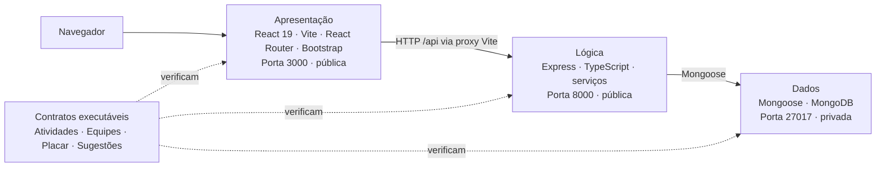

# Arquitetura do OctoFit Tracker

O OctoFit Tracker é uma aplicação de três camadas para um programa de atividades físicas escolar. O código inicial inclui contratos de API e pontos de implementação intencionalmente incompletos para que você use o modo agent do GitHub Copilot em um ciclo guiado por testes.

## Limites entre as camadas

- **Camada de apresentação**: React 19, Vite, React Router, Bootstrap e um cliente compartilhado da API em `octofit-tracker/frontend/src`.
- **Camada de lógica**: rotas e serviços Express com TypeScript em `octofit-tracker/backend/src` expõem o comportamento `/api/*` na porta `8000`.
- **Camada de dados**: modelos Mongoose e dados de demonstração em `octofit-tracker/backend/src/models` e `src/scripts/seed.ts` são persistidos no MongoDB na porta `27017`.

## Portas e regras de ambiente

- MongoDB: `27017` (privada)
- API Express: `8000` (pública)
- Interface Vite: `3000` (pública)
- O navegador acessa caminhos relativos `/api`. O Vite os encaminha para `http://localhost:8000`; `VITE_API_BASE_URL` pode substituir a URL-base.
- Não encaminhe nem torne públicas outras portas.

## Contrato da API

| Capacidade | Método e caminho | Comportamento esperado |
| --- | --- | --- |
| Registro de atividades | `GET /api/activities`, `POST /api/activities` | Lista e cria atividades válidas. POST recebe `userId`, `teamId`, `type` e `minutes`; `userId` e `teamId` devem ser IDs bem-formados de uma pessoa e uma equipe existentes, caso contrário a API retorna um 4xx intencional (nunca um 500 causado por erro de conversão). Uma atividade criada armazena `user`, `team`, `type` e `minutes` enviados, além de `points` e `occurredAt` calculados. |
| Equipes | `GET /api/teams`, `POST /api/teams` | Lista e cria equipes com integrantes. As equipes criadas e listadas mantêm os valores enviados em `name` e `mascot`. Rejeita uma equipe sem nome com `400`. |
| Placar | `GET /api/leaderboard` | Retorna as equipes ordenadas pela soma dos pontos de suas atividades, da maior para a menor. Cada item contém `teamName`, `totalPoints` e uma `rank` iniciada em 1. |
| Sugestões de treino | `GET /api/workouts/suggestions/:userEmail` | Recomenda treinos com base nos padrões de atividade recentes da pessoa correspondente ao e-mail seed. O foco da primeira sugestão (`focus`) corresponde à meta ou à atividade recente dessa pessoa, e o campo `reason` explica o motivo. Um e-mail sem pessoa correspondente retorna um 4xx intencional (por exemplo, `404`). |

## Decisões de implementação

- **Decisão da camada de apresentação:** manter componentes React responsáveis pela renderização e pelo estado de carregamento, vazio e erro; consumir a API somente pelo cliente compartilhado e por caminhos relativos `/api`.
- **Decisão da camada de lógica:** manter rotas Express finas e concentrar validações e regras de negócio nos serviços; responder com 4xx para entradas inválidas ou referências inexistentes, sem deixar erros de conversão virarem 500.
- **Decisão da camada de dados:** declarar campos obrigatórios, referências e padrões nos modelos Mongoose. Popular dados de demonstração pelo seed da aplicação, de forma idempotente e sem apagar registros não relacionados.
- **Abordagem para registro de atividades:** validar tipo, minutos e formato e existência dos IDs de pessoa e equipe; calcular pontos e data no backend e persistir as referências e os valores recebidos.
- **Abordagem para gerenciamento de equipes:** exigir nome e mascote, manter integrantes como referências de pessoas e retornar equipes e integrantes no formato previsto pelo contrato.
- **Abordagem para o placar:** somar os pontos das atividades por equipe, ordenar do maior total para o menor e atribuir posições sequenciais a partir de 1.
- **Abordagem para sugestões de treino:** localizar a pessoa pelo e-mail, considerar sua meta e atividade recente para ordenar sugestões e explicar o foco recomendado; retornar 4xx quando não houver pessoa correspondente.

Ordem mínima segura: validar modelos e seed; implementar e testar os serviços da API; conectar as telas ao contrato e cobrir seus estados; por fim, executar as compilações das duas camadas.

## Plano de testes

Resultados executados no scaffold atual:

- **Testes da camada de dados:** `npm run test:data --prefix octofit-tracker/backend` — falhou: 4 de 5 testes. Os modelos não sinalizam campos obrigatórios de pessoas, equipes, atividades e treinos; o teste de seed passou, incluindo idempotência e preservação de dados não relacionados.
- **Testes da API:** `npm run test:api --prefix octofit-tracker/backend` — falhou: 4 de 4 testes. As criações retornam `501` em vez de validar entradas e persistir; o placar está vazio; a sugestão de treino não inclui o motivo esperado.
- **Testes do frontend:** `npm test --prefix octofit-tracker/frontend` — falhou: 15 de 15 testes. As telas não exibem os dados esperados nem solicitam sugestões para Mona; nas quatro rotas, carregamento, estado vazio e erro não atendem ao contrato.
- **Compilação do backend:** `npm run build --prefix octofit-tracker/backend` — passou (`tsc --noEmit`).
- **Compilação do frontend:** `npm run build --prefix octofit-tracker/frontend` — passou (TypeScript e `vite build`).
